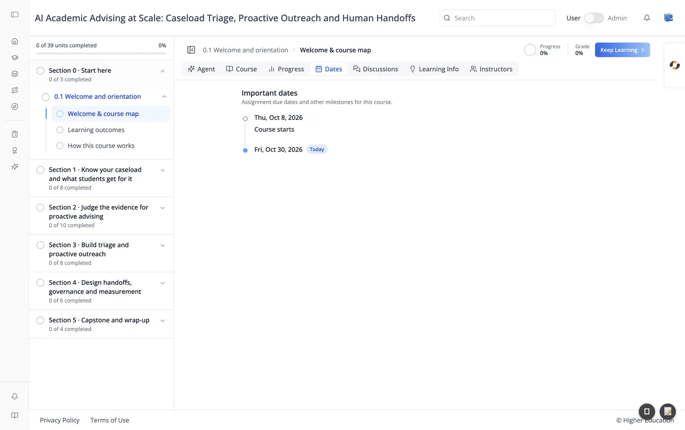

# Course: Dates Tab

## Overview

The Dates tab, headed "Important dates", lists "Assignment due dates and other milestones for this course." as a vertical timeline: when the course starts, when each assignment is due, and when the course ends. Today always has its own point on the timeline, marked **Today**, so you can see at a glance what is behind you and what is coming up.

## Target Audience

**Learner**

## Features

#### Timeline
Each point on the timeline is a day. Under it are the things that happen that day, for example "Course starts" or an assignment due date with its type and time. Dates are written in your browser's language and shown in your time zone; when your account has a time zone set, the subtitle names it.

#### Status badges
Days and assignments carry a badge when it helps:

| Badge | Means |
|---|---|
| **Today** | Today's date |
| **Completed** | You have finished the assignment |
| **Past due** | The due date has passed and the assignment is not finished |
| **Due next** | The next assignment you need to finish |
| **Not yet released** | The assignment is scheduled but not open yet |
| **Verified only** | The assignment is open only to learners on a verified track |

#### Shift due dates
In a self-paced course with a suggested schedule, missing a deadline shows a notice: "It looks like you missed some important deadlines based on our suggested schedule." Click **Shift due dates** to move the past-due assignments into the future without losing any progress. If you are auditing a course whose graded work is for verified learners only, the notice explains how to upgrade instead.

## How to Use

#### Step 1: Plan ahead
Check the tab at the start of the course and note each due date.

#### Step 2: Catch up
If you fall behind in a self-paced course, click **Shift due dates** to get a fresh schedule.

#### Step 3: Check your extensions
If the course team has given you more time on an assignment, your new due date shows here. See [Extensions](../course-administration/extensions.md).
