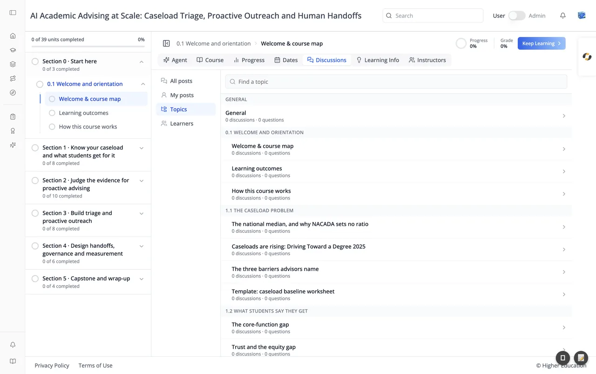
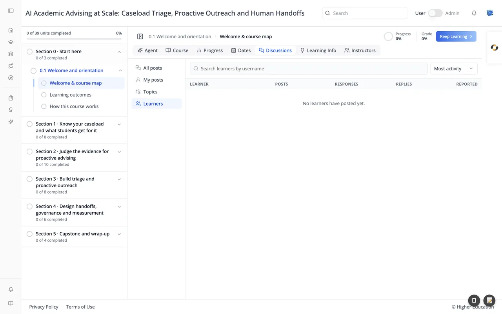

# Course: Discussions Tab

## Overview

The Discussions tab is the course forum, where learners and the course team post questions, answer each other, and talk about the material. A menu on the left switches between four views, and the view you pick opens on the right. Units can also link to a discussion topic of their own.

When there are no posts yet, the page reads "Nothing here yet. Be the first to start a conversation."

## Target Audience

**Learner** | **Course staff** (moderators and community TAs)

## Features

#### All posts and My posts
**All posts** lists every post in the course; **My posts** lists the posts you wrote. Both have the same tools above the list:

- **Search all posts**: searches post titles and text.
- **Post type**: **All post types**, **Discussions**, or **Questions**.
- **Status**: **Any status**, **Unread**, **Following**, **Unanswered**, or **Unresponded**. Course staff also get **Reported**.
- **Sort**: **Recent activity**, **Most activity**, or **Most votes**.

Click a post to open it with its responses and replies.

#### Topics

Topics follow the course outline: a **General** topic, then one heading per subsection with a topic for each of its units (for example "Welcome & course map" under "0.1 Welcome and orientation"). Each topic shows how many discussions and questions it holds. Type in **Find a topic** to filter the list, and click a topic to see its posts.

#### Learners

A table of everyone who has taken part, with their **Posts**, **Responses**, **Replies**, and **Reported** counts. Search by username, and sort by **Most activity** or **Recent activity** (course staff can also sort by **Most reported**). Click a learner to see their posts. The course team can turn this view off.

#### Add a post
Click **Add a post** and choose a **Post type**: **Question** ("Ask something and get an answer") or **Discussion** ("Share ideas and start a conversation"). Then pick a **Topic area**, give the post a title, and write it; Markdown is supported. **Follow this post** is ticked by default so you hear about replies, and courses that allow it offer **Post anonymously**.

#### Inside a post
Vote for a post or a response, follow or unfollow the post, copy a link to it, or report it to the course team. Reply to a response to start a thread under it. You can edit or delete your own posts and responses.

#### Moderation
Moderators, administrators, and community TAs can also edit, pin, close, reopen, and delete any post, and mark a response as the answer to a question or endorse it. These roles are given in [Membership](../course-administration/membership.md).

## How to Use

#### Step 1: Look before you post
Search **All posts**, or browse **Topics**, to see whether someone has already asked your question.

#### Step 2: Add a post
Click **Add a post**, choose Question or Discussion, pick a topic, and write your post.

#### Step 3: Follow up
Open **My posts**, or set the status filter to **Following**, to see replies to the posts you care about.
