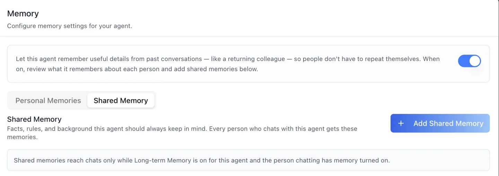
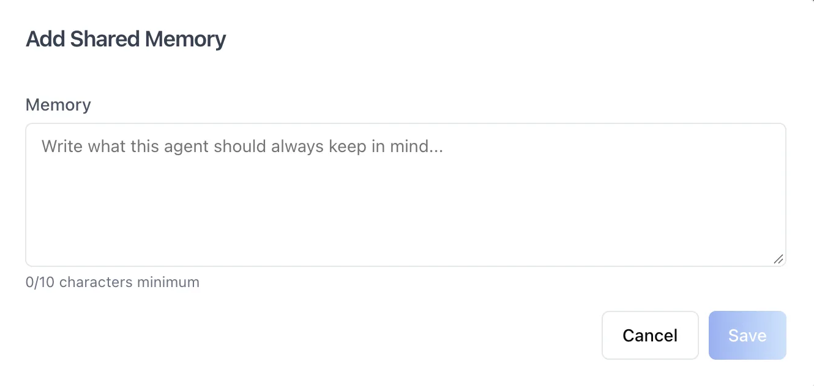
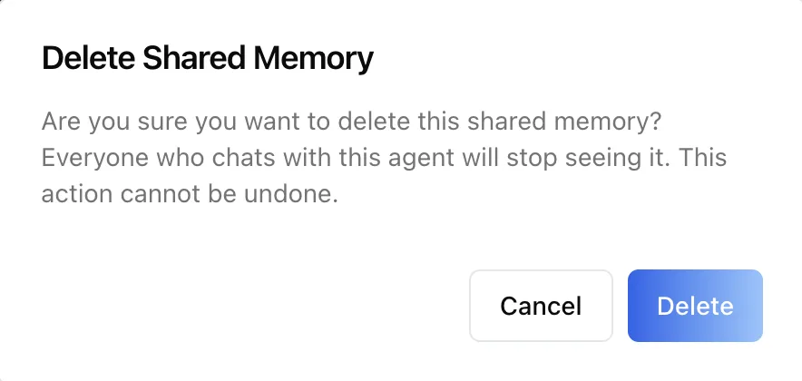

# Agent Settings: Memory

## Overview

The Memory panel manages what an agent remembers. Its header reads "Configure memory settings for your agent," and the helper text explains the **Long-term Memory** switch: "Let this agent remember useful details from past conversations — like a returning colleague — so people don't have to repeat themselves."

While the switch is on, the panel shows two sub-tabs that hold two different kinds of memory:

- **Personal Memories** — what the agent has learned about each individual person, filed by category. These are captured automatically from conversations (or added by hand) and belong to one user at a time.
- **Shared Memory** — "Facts, rules, and background this agent should always keep in mind. Every person who chats with this agent gets these memories." These are written only by hand and have no user attached: everyone who talks to the agent receives them.

To reach this screen, open the **Edit Agent** modal, switch to the **Runtime** tab group (its sidebar lists Tasks, Memory, History, Audit, and Analytics), and select **Memory**.

## Target Audience

**Administrator** | **Agent Builder**

## Panel Reference

#### Long-term Memory switch
The switch in the helper banner enables or disables memory for this agent. When on, the agent stores and references useful details from conversations and injects its Shared Memory into every chat; when off, both sub-tabs stay visible but nothing from either store reaches a conversation. This is the agent-level gate — see [Which switches control memory](#which-switches-control-memory) below for the other two. Conversations in Incognito mode never store memory regardless of this setting.

#### Personal Memories / Shared Memory sub-tabs
Two tabs directly under the switch. **Personal Memories** is the per-person store described in the next five entries; **Shared Memory** is the agent-wide store described after it.

#### Search for User (Personal Memories)
A searchable dropdown listing the users who have saved memories (by email), plus an **All Users** option. Selecting a user filters the memory list to just that person.

#### Pick a Date Range (Personal Memories)
Filters the memory list to entries captured within a chosen date range.

#### Category tabs (Personal Memories)
Filter tabs across the top of the list: **All** plus the agent's memory categories. Five categories seed themselves the first time the agent extracts a memory — Knowledge Gaps, Learning Goals, Preferences, Progress Milestones, and Personal Context — which is why a brand-new agent can show an empty category list, and why the screenshot shows only the four this agent has used so far. Up to six categories are shown inline; additional ones collapse into a **More** menu.

#### Categories (Personal Memories)
Opens the **Manage Categories** dialog, where you can add a new category by name (each with its own extraction prompt), rename existing ones, and delete them with confirmation. Categories structure how personal memories are classified and filtered.

#### Add Memory and memory cards (Personal Memories)
**Add Memory** opens a dialog: pick a **Category**, type the **Memory** content (10-character minimum), and click **Save**. Each saved memory is a card showing its relative timestamp, the owning user's email, and the memory text; the "..." actions menu on a card offers **Edit** (change the content or category) and **Delete** (with confirmation).

#### Shared Memory list

One card per entry, twenty to a page, each showing the text and **"Added by {name} · {time ago}"**, so a reviewer can see who curated a line and when. The note under the heading states the rule that governs the whole sub-tab: "Shared memories reach chats only while Long-term Memory is on for this agent and the person chatting has memory turned on."

#### Add Shared Memory

Opens a single-field dialog — "Write what this agent should always keep in mind..." — with a counter that reads **0/10 characters minimum** until ten characters are typed. **Save** stays disabled below that floor. Entries deduplicate on content: saving a line that already exists is rejected and the field shows "This shared memory already exists." Good entries are short standing facts, such as "Our refund window is 30 days" or "Always cite the policy handbook."

#### Edit and Delete (Shared Memory)

Every shared-memory card carries a "..." menu with **Edit**, which reopens the same dialog with the text loaded, and **Delete**, which asks first: "Everyone who chats with this agent will stop seeing it. This action cannot be undone."

## How to Use

#### Step 1: Open the Memory panel
Open the **Edit Agent** modal, click the **Runtime** tab group, then select **Memory**.

#### Step 2: Turn memory on
Enable the **Long-term Memory** switch so the agent remembers useful details from past conversations and injects its Shared Memory. Pair this with the **Remember past conversations** capability so memory is active in chat.

#### Step 3: Review what the agent remembers about people
On **Personal Memories**, filter by user with **Search for User**, narrow by date with **Pick a Date Range**, and switch category tabs to audit stored memories. Use **Add Memory** to insert a fact about one person, the card's **Edit** action to fix an inaccurate one, and **Delete** to remove anything that should not be retained.

#### Step 4: Write what the agent should always know
Switch to **Shared Memory** and click **Add Shared Memory** for each standing fact, rule, or piece of background every conversation should start with. Edit an entry when the fact changes; delete it when it no longer applies.

#### Step 5: Maintain categories
Back on **Personal Memories**, click **Categories** to add, rename, or remove memory categories as your classification needs evolve.

## Which switches control memory

Three switches decide whether anything on this panel reaches a conversation, and they cascade top-down: a level that is off stops everything beneath it, whatever the lower levels say.

| Level | Where it is set | What off means |
|---|---|---|
| **Organization** | Memory search in the organization's settings | No memory for anyone, however many agents are configured |
| **Agent** | The **Long-term Memory** switch on this panel | No memory for this agent — neither store is injected |
| **Person** | The two toggles on the user's own [Profile: Memory](/docs/os/profile/memory) tab | The individual has opted out of capture, of personalization, or of both, even while the organization and the agent are on |

## Behavior Notes

- **Shared Memory is never captured automatically.** Personal memories are extracted from conversations by a background job; shared memories exist only because a person typed them and clicked **Save**. Nothing an individual says in a chat can end up in the store that every other person receives.
- **Never put something about one person into Shared Memory.** Everyone who talks to the agent will read it. A fact about an individual belongs in Personal Memories, where it is scoped to its owner and can be corrected or deleted on their request.
- **What the model sees.** On each new message the platform retrieves the most relevant personal memories and prepends them to the system prompt together with the agent's Shared Memory, which arrives as an `## Agent Knowledge` block. Memory is retrieved by relevance, not pasted in wholesale.
- **Who may change Shared Memory.** There is no separate shared-memory permission; the agent's own edit permission applies. With role-based access control on, a Limited Editor can add and edit shared memories and a Limited Viewer cannot. If the server refuses a write, the **Add Shared Memory** button and the per-entry menus disappear for the rest of the session rather than offering an action that will fail.
- **The same personal memories have three doors.** What you see on Personal Memories is also reachable, for every agent at once, from the organization's [Memory settings](/docs/os/organization-settings/memory), and each user sees their own cross-agent memories on their Profile. Shared Memory is managed only here, on the agent's own panel.
